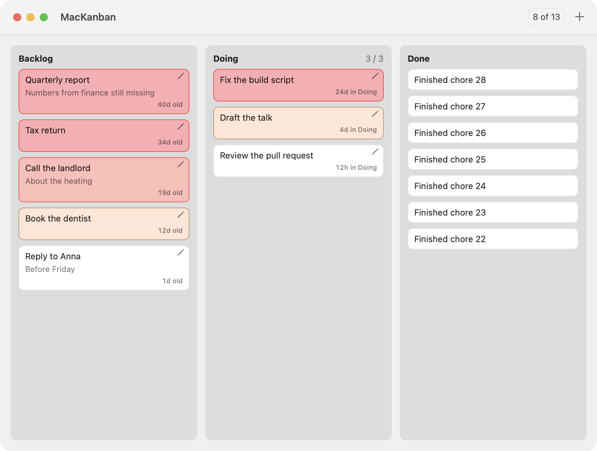
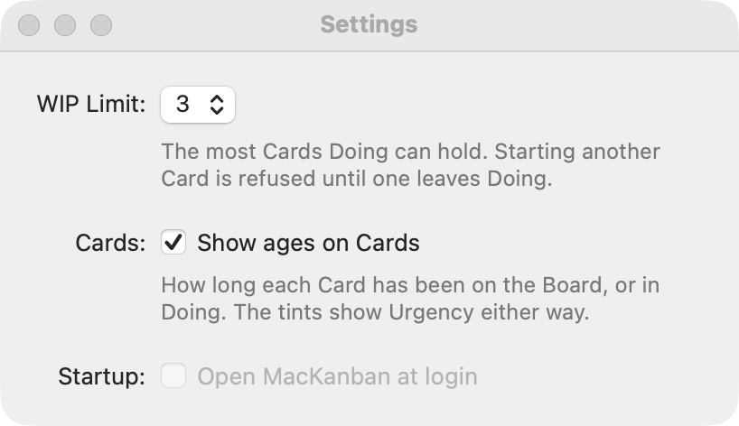
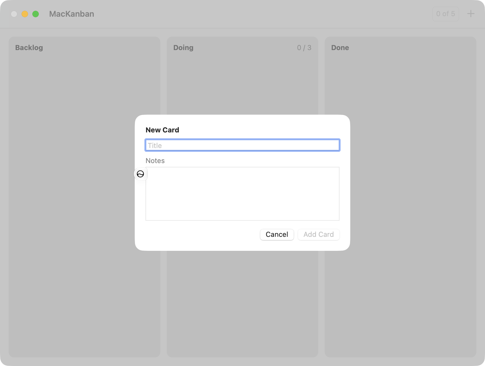
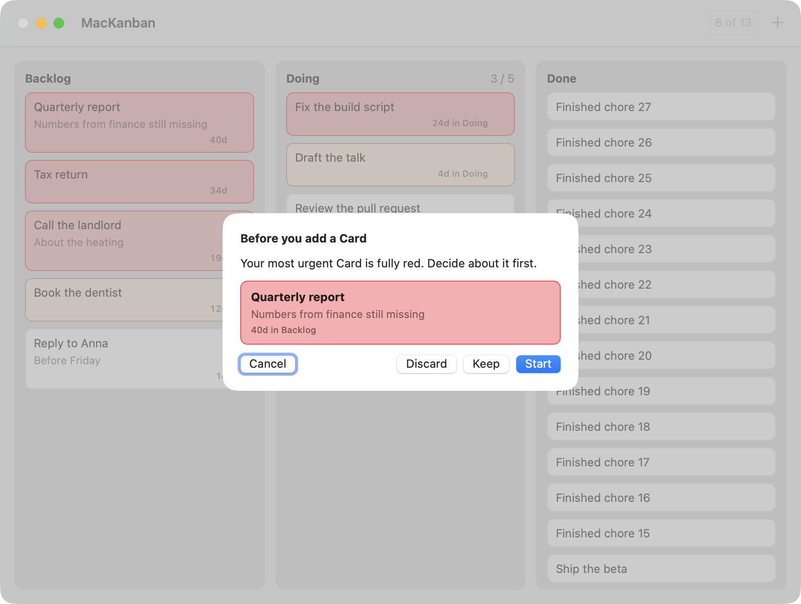
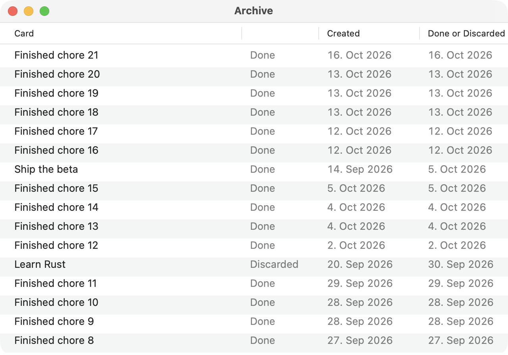
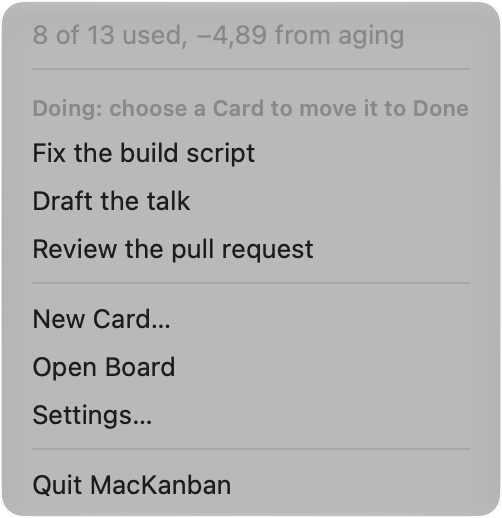

# HIG audit: MacKanban's interface

Audited 2026-10-24 against Apple's Human Interface Guidelines (pages: Layout, Buttons, Toolbars, Settings, Menus, The menu bar, Alerts, Toggles, Typography, Sheets), read from developer.apple.com, and against what MacJot settled in its own HIG audit ([MacJot](https://github.com/christoph-bennett/MacJot), tickets 20 to 22). Screenshots are of the running app on sample Boards, light mode, at 2×.

**What the HIG gives and what it doesn't.** As MacJot found, the HIG's Layout page has no spacing numbers for macOS, only principles: "Align elements to make them easier to scan" and "Group related items … using negative space, container shapes, or separator lines". Concrete numbers below come from the HIG where it has them (Buttons, Typography, The menu bar), from MacJot's decisions (Settings spacing), and from MacKanban's code.

Answer per number: **fix**, **skip**, or **change** (with what).

**Answered 2026-10-24:** fix 1 to 11 (1 as the hover button, not removed; 5 in the View menu only), skip 12.

---

## Board window

(The pencils normally appear only under the pointer; this screenshot shows them all.)

### 1. The edit pencil doesn't look or behave like a button

- **Now:** a thin 11 pt grey `pencil` glyph, borderless, 6 pt from the Card's top-right corner. It has no shape, no highlight under the pointer and no press state; its clickable area is about the glyph's own size. On a tinted Card it reads as a stray mark rather than a control.
- **HIG, Buttons:** "Always include a press state for a custom button." For image buttons on macOS: "Include about 10 pixels of padding between the edges of the image and the button edges. An image button's edges define its clickable area even when they aren't visible." And in general: "include enough space around a button so that people can visually distinguish it from surrounding components."
- **Proposal:** keep it hover-only, but make it a real accessory button: AppKit's accessory-bar style with its border shown only while the pointer is inside (a soft rounded highlight, plus the standard press state), a 22 × 22 pt frame with the symbol at 12 pt medium weight, placed so its frame sits inside the Card's padding (4 pt from top and right). Alternative: drop the pencil entirely, since double-click, Return, the context menu and Card > Edit Card… already open the Card (*fix* / *fix by removing* / *skip*).

### 2. Card padding is uneven

- **Now:** 8 pt above and below the text, 10 pt left and right. The title sits visibly closer to the top edge than to the left one.
- **HIG, Layout:** alignment and consistent negative space; no number for macOS.
- **Proposal:** 10 pt on all four sides. Cards grow by 4 pt each; the gaps between Cards (8 pt) and the Column's inset (12 pt) stay, so "inside a Card" < "between Cards" < "Column edge" still reads as three levels.

### 3. The two toolbar items look different

- **Now:** the Capacity gauge ("8 of 13") draws its own rounded box; the New Card **+** next to it has none. Two neighbouring items in the same toolbar look like they come from different apps.
- **HIG, Toolbars (macOS):** "toolbar items don't include a bezel", and "Prefer using standard components in a toolbar … If you need to create a custom component, ensure that its corner radius is also concentric with the bar's corners."
- **Proposal:** draw the gauge without its own border, as plain coloured text like the **+** beside it. It stays clickable for the breakdown popover and keeps its tooltip.

### 4. "New Card" has no ellipsis in the File menu, but has one in the menu bar extra

- **Now:** File > **New Card** (⌘N), menu bar extra > **New Card…**. Both open the same sheet that asks for a title.
- **HIG, Menus:** "Append an ellipsis to a menu item's label when the action requires more information before it can complete."
- **Proposal:** **New Card…** in the File menu too (and in the toolbar button's tooltip).

### 5. "Show ages on Cards" is a view option, not a setting

- **Now:** a checkbox in Settings.
- **HIG, Settings:** "When possible, prefer letting people modify task-specific options without going to your settings area. For example, if people can adjust things like showing or hiding parts of the current view … make these options available in the screens they affect." And: "Minimize the number of settings you offer."
- **Proposal:** a **View** menu with **Show Card Ages** (switching to **Hide Card Ages** while shown, like Finder's View > Show Path Bar / Hide Path Bar), and remove the checkbox from Settings. The choice is still remembered, per store, as now. (*fix, View menu only* / *fix, both places* / *skip*)

---

## Settings

### 6. The window title should name the app

- **Now:** "Settings".
- **HIG, Settings (macOS):** "If your settings window doesn't have multiple panes, use the title App Name Settings."
- **Proposal:** "MacKanban Settings".

### 7. Spacing inside and between settings

- **Now:** each explanation sits 8 pt below its control; settings are 20 pt apart (8 pt rows plus 12 pt extra); margins are 20 pt on every side.
- **HIG, Layout:** group related items with negative space. MacJot's audit (findings 1 to 3, ticket 20) turned that into one rule for its Settings: an explanation 4 pt below its control, 16 pt between settings, margins 30 pt left and right and 20 pt top and bottom.
- **Proposal:** the same rule here, so both apps' Settings windows look alike: explanation 4 pt below its control, 16 pt between settings, 30 pt side margins, 20 pt top and bottom. (If finding 5 moves the ages checkbox out, Settings keeps two settings: WIP Limit and Startup.)

---

## Sheets

### 8. The New Card sheet's two fields don't match

- **Now:** the title field has only a placeholder ("Title", gone as soon as you type), while Notes has a label above its box. The title field has the rounded macOS text-field border; the notes box has the older square bezel.
- **HIG, Layout:** "Align elements … People assume that aligned items are related"; consistency between related controls.
- **Proposal:** a "Title" label above the title field, styled like "Notes", and give the notes box the same rounded corners and border colour as the title field.

### Checked and fine: the Triage and blocked sheets

- Button order: Cancel on the leading side, the default button (Start) on the trailing side. **HIG, Alerts:** "Always place the default button on the trailing side of a row … Cancel buttons are typically on the leading side of a row." The New Card and edit sheets follow the same order.
- Start is the default button only when it's available; when it isn't, no button takes Return. **HIG, Buttons:** don't make a destructive action the default; Discard never is.
- Esc closes every sheet.

---

## Archive window

### 9. One column has no header

- **Now:** the column saying "Done" or "Discarded" has an empty header.
- **HIG, Layout / Lists and tables:** column headers describe their content.
- **Proposal:** header **Outcome**.

---

## Menu bar extra

### 10. The coloured icon stays coloured while its menu is open

- **Now:** amber and red icons are coloured images, so when the menu opens they keep their colour on the highlighted background.
- **HIG, The menu bar:** "Both interface icons and symbols use black and clear colors to define their shapes; the system can apply other colors to the black areas in each image so it looks good on both dark and light menu bars, and when your menu bar extra is selected." The tint itself is a deliberate exception (spec story 37) and stays.
- **Proposal:** while the menu is open, show the plain template icon (which the system highlights correctly), and the coloured one again when it closes.

### 11. The section header is a sentence

- **Now:** "Doing: choose a Card to move it to Done".
- **HIG, Menus:** keep menu content short and scannable (Apple's own section headers are one or two words).
- **Proposal:** header **Move to Done**, with the Doing Cards below it.

### 12. Known deviation: the extra is always in the menu bar (recommend skip)

- **HIG, The menu bar:** "Let people — not your app — decide whether to put your menu bar extra in the menu bar. Typically, people add a menu bar extra to the menu bar by changing a setting."
- **Why skip:** MacKanban keeps running after its window closes so the icon can show the Board's state; the extra is the app's background presence (spec stories 36 to 38). A setting to hide it would add a setting for little gain.

---

## Checked and fine

- **Typography:** every text uses a macOS text style at or above the 10 pt minimum: Column headers Headline (13 pt bold), Card titles Body (13 pt), notes Callout (12 pt), age labels Caption 1 size (10 pt, medium, monospaced digits). **HIG, Typography:** macOS default 13 pt, minimum 10 pt.
- **Settings window:** opens with ⌘, from the app menu; no minimize or zoom; a fixed size. **HIG, Settings (macOS).**
- **Toolbar commands are in the menu bar:** New Card is File > New Card (⌘N). **HIG, Toolbars.**
- **Checkboxes** for on/off settings, not switches. **HIG, Toggles.**
- **No alert for Discard:** it's undoable. **HIG, Alerts:** "Avoid displaying alerts for common, undoable actions, even when they're destructive."
- **The menu bar extra shows a menu, not a popover.** **HIG, The menu bar.**

## Not covered

- Dark mode: checked by hand earlier (tickets 05, 11); no layout differences.
- Focus rings and keyboard navigation inside the sheets: only checkable by hand.

---

## Done 2026-10-24

All eleven fixes are in; screenshots of the result are in `after/`:

1. The pencil is an accessory button: a 22 × 22 pt frame 4 pt from the corner, 12 pt medium symbol, a rounded highlight under the pointer and a press state (`showsBorderOnlyWhileMouseInside`). Still hover-only.
2. Cards have 10 pt padding on all sides.
3. The gauge has no border of its own at rest; like other toolbar buttons it shows the toolbar highlight under the pointer and a press state.
4. File > **New Card…**. (The toolbar tooltip stays "New Card (⌘N)": the ellipsis rule is for labels, not tooltips.)
5. **View > Show Card Ages** / **Hide Card Ages** (the title says what choosing it will do, as in Finder; first built as a checkmark item, corrected after the review); the checkbox is gone from Settings. Still remembered per store.
6. "MacKanban Settings".
7. Explanations 4 pt below their control, 16 pt between settings, margins 30 pt at the sides and 20 pt top and bottom.
8. "Title" label above the title field; the notes box has a rounded 6 pt border in the separator colour (drawn on a container: on the scroll view itself its clip view covered it).
9. Archive column header **Outcome**.
10. While the menu is open, the icon is the plain template (the menu bar highlights it); coloured again when it closes.
11. Menu header **Move to Done**.

Not checkable by screenshot: the pencil's and the gauge's highlight under the pointer and their press states, the View menu's Show/Hide title.

Code review (medium) of the fixes: added VoiceOver names for the Title and Notes fields (the placeholder had been the title field's only name); the gauge got back the toolbar highlight and press state; the status menu reads the Board once per opening instead of three times; Show/Hide Card Ages instead of a checkmark; the tooltip's ellipsis removed. Skipped: the pencil's highlight is missing when a Card is rebuilt under a still pointer (it appears as soon as the pointer moves); menu items stay enabled after a failed launch (MacKanban quits right after its alert).

**Changed 2026-10-24, finding 5 reverted at Christoph's request:** "Show ages on Cards" is back in Settings (with finding 7's spacing) and the View menu is gone. The HIG would put it in the View menu, but people would look for it in Settings.

**Changed 2026-10-24, finding 1:** at Christoph's request the pencil now always shows a filled accent chip while its Card is hovered (deeper under the pointer and when pressed), instead of a highlight only under the pointer.
