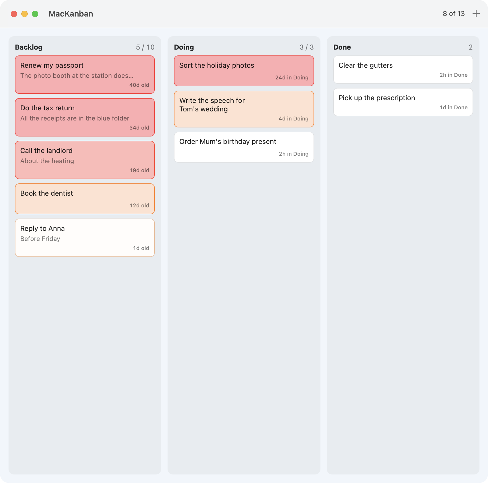
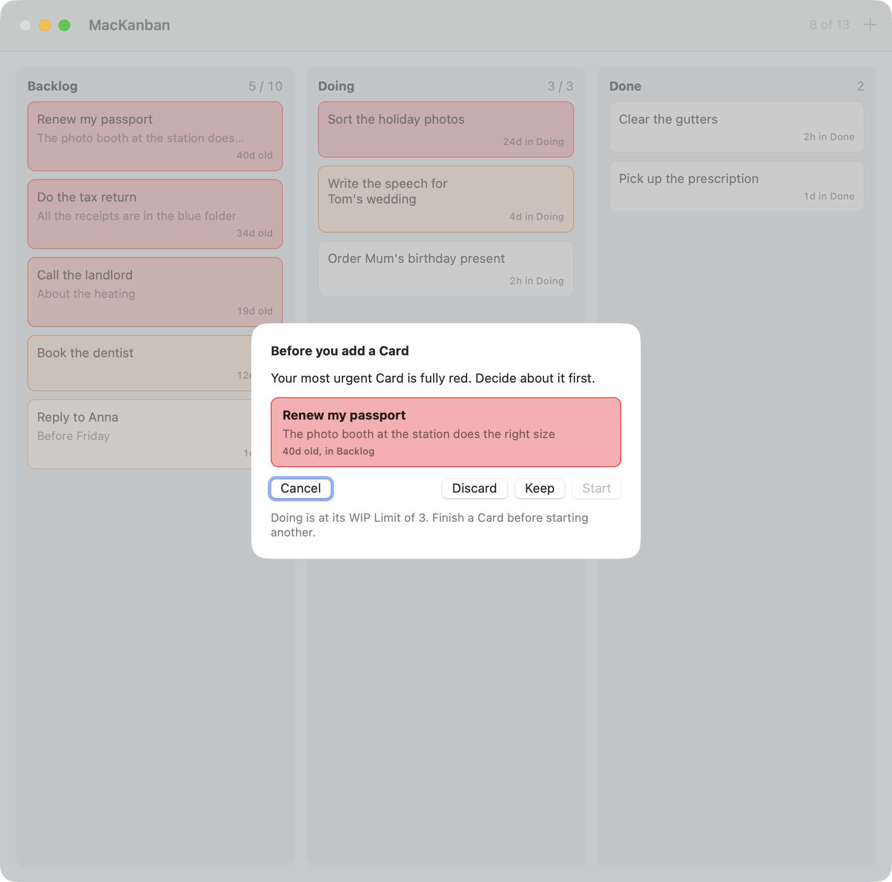
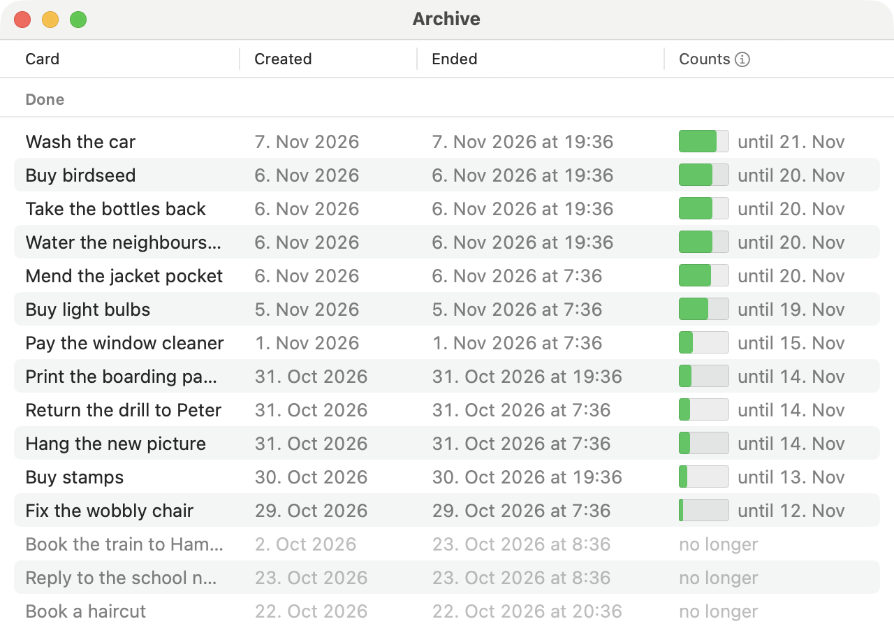
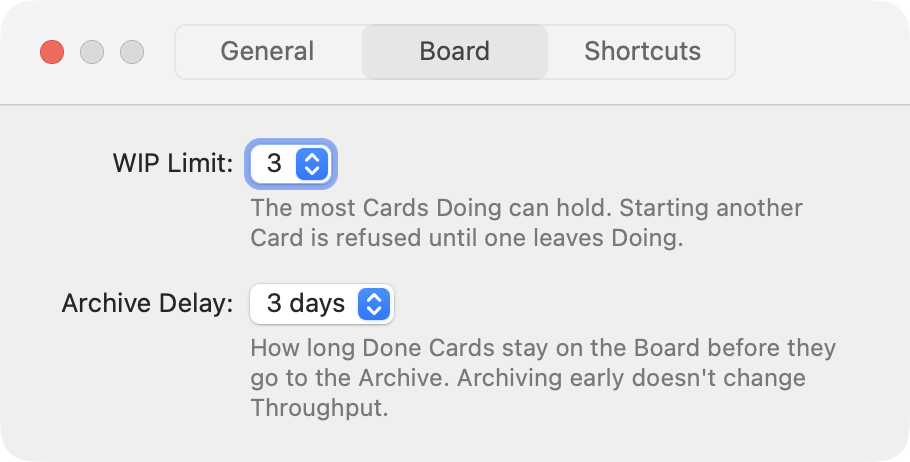

# MacKanban

A procrastinator's Kanban board for macOS. Cards age where you can see them, and the board stops you from adding more when old work sits untouched.

## Why this exists

I can be a procrastinator at times, and every to-do list I've tried turned into a dumping ground. Adding a task costs nothing, so the list keeps growing. The old tasks sink to the bottom, and after a few weeks the list no longer says what I'm actually going to do. It only records what I once meant to do.

I've used Kanban successfully in many work projects over the years, so it was the system I wanted to build on. What I wanted was a procrastinator's Kanban for myself: a board that makes old work impossible to ignore and pushes back when I keep adding things while nothing gets finished. So I had Claude Code build one. MacKanban is first of all my own tool. I use it every day, and its rules are the ones I need, not a set of options for everyone.

<p align="center">
  
</p>

## How it works

### Three Columns

The Board has three Columns, and you can't add, rename or remove them.

- **Backlog** holds everything you've captured but not started. Every new Card starts here, so starting work is always a second, deliberate step. The oldest Card is always at the top. You can't reorder the Backlog, because then the old Cards would quietly end up at the bottom again.
- **Doing** holds what you're working on now. It has a WIP Limit (work in progress): when Doing is full, MacKanban won't let you start another Card until you finish one or move it back.
- **Done** holds what you've finished. Done Cards can't be edited or moved back. After a few days they leave the Board for the Archive.

### Cards age

Every Card shows how old it is and slowly changes color, from white through amber to red. The color is the Card's Urgency.

- In **Backlog**, a Card starts to color after half a day and is fully red after 21 days.
- In **Doing**, a Card starts to color after 4 hours and is fully red after 7 days. Something you've started should get finished soon, so the clock runs faster here.
- Moving a Card back and forth doesn't reset anything. Time in Doing adds up across every visit, and renaming a Card doesn't make it younger.

### Capacity: room for new Cards

The Board only takes so many open Cards (Backlog and Doing together). The header shows how much of that room you've used, for example "8 of 13".

- You start with room for **5** Cards.
- Every Card you finish gives you room for **one more**, for 14 days.
- Every aging Card takes some room away. A fully red Card takes a whole place on its own, on top of the place it already uses.
- The room never goes above 20.

So the Board grows when you get things done and shrinks when things go stale. A weekend away can leave you with no room at all. That is on purpose.

When the room is nearly used up, or a Card has turned fully red, adding a new Card first shows you the most urgent Card. You decide about it before you can add anything: start it, keep it as it is, or discard it. You can also cancel and add nothing. This step is called Triage.

<p align="center">
  
</p>

When the room is used up completely, MacKanban won't let you add a Card at all until you finish or discard one.

### Letting go

Some things never get done, and that's fine. **Discard** takes a Card off the Board and frees its room, but it doesn't count as finished, so it gives you nothing extra. If you discarded something by mistake, you can restore it from the Archive. It comes back as old as it was, so it needs room for itself and for its age.

### The Archive

Finished Cards stay on the Board for a few days, then move to the Archive along with the discarded ones. For each finished Card, the Archive shows how much longer it still gives you room.

<p align="center">
  
</p>

### The rules don't bend

None of the numbers above can be changed. A setting like "fully red after a year" would switch the whole idea off, and a procrastinator would find that setting within a week. I know I would.

### Settings for the Board

Two settings shape how the Board behaves:

- **WIP Limit** (1 to 5, default 3): how many Cards Doing can hold. A low limit makes you finish things before starting new ones.
- **Archive Delay** (1, 2, 3, 5 or 7 days, default 3): how long finished Cards stay on the Board before they go to the Archive. It only changes what you see. A finished Card gives you room for 14 days either way.

<p align="center">
  
</p>

### Everyday use

MacKanban lives in the menu bar. Its icon takes on the color of your most urgent Card, and its menu shows how much room is used and what's in Doing. Two hotkeys work from any app: ⌃⌥⇧⌘K shows the Board and ⌃⌥⇧⌘M adds a Card. You can change both in Settings. Esc closes the Board and takes you back to where you were, and ⌘Z undoes a move, a Discard or a new Card right after a slip.

On first launch, MacKanban offers a few Sample Cards so you can see a Board with Cards of every age. You can remove them again from the menu bar menu.

The capitalized terms (Card, Urgency, Capacity, Triage and so on) are defined in [`GLOSSARY.md`](GLOSSARY.md).

## How it is built

- `KanbanCore` holds all the rules: the Columns, Urgency, Capacity, Triage and the Archive. It is the part with tests.
- `MacKanban` is the app. It uses AppKit for the windows and the menu bar.
- `SampleBoard` is a small command-line tool that writes a sample Board for trying things out and taking screenshots.
- The Board is saved in `~/Library/Application Support/MacKanban/Board.sqlite` with Core Data. MacKanban records every change to a Card as an event, and the Board's state is worked out from those events. [ADR 0002](docs/adr/0002-core-data-event-log.md) explains why.

The decisions behind the rules are in [`docs/adr/`](docs/adr/), the specs in [`docs/specs/`](docs/specs/).

## Building from source

You need a Mac with Swift 6: Apple's Command Line Tools (`xcode-select --install`) or Xcode. There is no Xcode project: Swift Package Manager builds the app, and a few shell scripts turn the binary into a signed `.app`. I build and use it on macOS 27. The minimum the package declares is macOS 14, but I haven't tried anything older than 27.

```sh
git clone https://github.com/christoph-bennett/MacKanban.git
cd MacKanban
scripts/bundle.sh     # builds build/MacKanban.app
scripts/install.sh    # copies it to ~/Applications and starts it
```

The scripts:

- `scripts/bundle.sh` builds a release binary with `swift build`, wraps it in `build/MacKanban.app` with its icon and `Info.plist`, sets the build number to the number of commits, and signs it ad hoc. Pass `debug` for a debug build. The ad-hoc signature is fine for your own Mac. Sharing a build with others would need a Developer ID and notarization.
- `scripts/install.sh` replaces `~/Applications/MacKanban.app` with the fresh build and starts it. It quits a running copy first. It doesn't build, so run `bundle.sh` before it.
- `scripts/test.sh` runs the `KanbanCore` tests. With only the Command Line Tools installed, it adds the flags `swift test` needs to find the testing framework.
- `scripts/make-icon.sh` turns `Resources/AppIcon.png` into `Resources/AppIcon.icns`. `swift scripts/icon-artwork.swift Resources/AppIcon.png` redraws the artwork first. You only need them after changing the icon.

### Trying it without touching your own Board

`SampleBoard` writes a Board with Cards of every age to a file of your choice:

```sh
swift run SampleBoard --replace /tmp/sample.sqlite
pkill -x MacKanban
open -n --env MACKANBAN_STORE=/tmp/sample.sqlite ~/Applications/MacKanban.app
```

That copy of MacKanban uses the sample file and its own settings, so nothing you do there reaches your real Board. Add `--blocked` to get a Board that is already full. The screenshots in this README come from such a sample Board.

## Status

MacKanban does what I wanted from it, and I use it every day on my own Mac. It is a personal tool, tested on one machine. A look back at the Board's history (how much I finish, where Cards get stuck) is planned.

## Further reading

If you're interested in the Kanban method itself, I recommend David J. Anderson's book *Kanban: Successful Evolutionary Change for Your Technology Business*.

## Acknowledgements

- [KeyboardShortcuts](https://github.com/sindresorhus/KeyboardShortcuts) by Sindre Sorhus records and registers the global hotkeys. It is included in `Vendor/` with small patches (MIT license).
- Built with [Claude Code](https://claude.com/claude-code).

## License

MIT. See [`LICENSE`](LICENSE).
